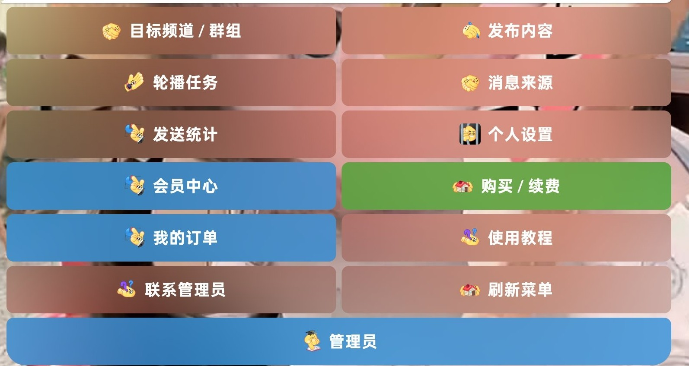

# TG Auto Ad Bot

<p>
  
  
  
  
</p>

[中文](README.md) · **English**

A Telegram advertising bot: bind channels and groups, store ad creatives, schedule multi-target rotation, mirror new posts from a source channel, with membership billing and a full in-Telegram admin console.

> **Live demo**: <https://t.me/KunKunGuangGaoBot> — send `/start` to open the menu; system admins send `/admin`.

- Open sourced by TG KunKun [@sad1881](https://t.me/sad1881) — available for custom work, feel free to reach out.

---

## What it is

A Telegram ad bot with no web dashboard. Everything happens in a private chat: add the channels and groups you want to target, write an ad (text, photo, video, animation or document), set the interval and repeat count, and the task rotates through your targets. Bind a source channel and new posts are queued for mirroring within seconds.

All content, tasks and per-target delivery results live in PostgreSQL. The receiving service and the sending worker are separate processes and resume from database state after a restart. When a network result is ambiguous the bot **does not blindly resend** — it records `UNKNOWN`, pauses that chain and lets a human decide whether to resend or skip.

It uses the official Bot API long polling only: no user-account sessions, no unofficial protocols, no attempts to bypass Telegram limits.

## Preview



> The actual main menu of the demo bot @KunKunGuangGaoBot: all 13 entries carry custom-emoji icons, with colored buttons for membership, purchase and orders.

| Menu | Purpose |
| --- | --- |
| 🐱 Targets | Paste usernames, links or chat IDs in bulk; bottom picker for private groups; verified by both-side admin check |
| 📥 Creatives | Text / photo / video / animation / document; native formatting and custom-emoji entities preserved; preview before saving |
| 🎠 Rotation tasks | Multi-content A→B→C loop across many targets, minute or `H:MM` intervals, limited or unlimited repeats |
| 📣 Sources | Separately authorized source channels; copy a known message (buttons optional) or forward natively; new posts queued instantly |
| 📊 Statistics | Per-user-timezone daily stats, task status, per-target send/delete results, errors, message links |
| ⚙️ Settings | IANA timezone, tutorial, contact |
| 💎 Membership | Plan status, target usage, expiry, permanent add-on quota |
| 🧾 Orders | Order id, amount, plan, status and payment entry |
| 🏠 Purchase | Weekly / monthly / quarterly plans and permanent add-ons |
| 📖 Tutorial | Admin-configurable walkthrough |
| 💬 Contact | Admin-configurable contact |
| 🔄 Refresh menu | Re-render the main menu |
| 🐳 Admin | Users, tasks, broadcasts, billing, allow-list config and audit log |

## Features

- 📢 **Multi-target rotation** — one creative delivered to dozens of channels and groups, with a separate delivery record per task, target and content version.
- 🗂 **Five content types and versioning** — text, photo, video, animation, document. Edits create a new version while queued publish events keep an independent snapshot, so editing never rewrites history.
- 🔁 **Delete old, post new** — optionally delete the previous message this task sent to the same target; deletion pointers are scoped per task and target, so another user's message is never touched.
- ⚡ **Instant source mirroring** — new posts from a bound source go into their own queue, serialized with scheduled publishing, deduplicated, with source-loop detection. Instant events never advance the rotation cursor.
- 🎨 **Custom emoji and colored buttons** — parses custom-emoji entities straight out of the message and preserves `primary` / `success` / `danger` button styles; no copying emoji IDs by hand.
- 🧩 **Button syntax** — several buttons per row, line breaks, URL buttons, all previewed with the content.
- 🛡 **In-bot admin console** — user search and bans, task/log overview, allow-list configuration, broadcasts (media, custom emoji, protected content), a 20-cell live progress view, failed-recipient export and an audit log.
- 💳 **Membership billing** — 10 USDT / week, 30 / month, 66 / quarter; permanent add-ons of 10 targets for 3 or 50 for 10. Payment credentials are encrypted with a standalone Fernet key that never reaches sessions, logs or audit bodies.
- 🧾 **Persistent SQL state** — users, bindings, sources, content versions, tasks, sessions, publish snapshots, per-target deliveries, broadcast recipients, messages and audit records. Media is stored as Telegram `file_id`.
- 🚦 **Rate limits and recovery** — a cross-process free-send budget that honors global and per-chat limits and `retry_after`; recovery from SQL after a crash, with in-flight requests parked as `UNKNOWN`.
- 🔍 **Health checks and backups** — `scripts/health.py` judges real availability from heartbeats (a live process does not mean messages get delivered); `scripts/backup.py` / `scripts/restore.py` take consistent snapshots and verify restores into an empty database.

## Layout

```text
tg-auto-ad-bot/
├── adbot/
│   ├── main.py           # receiving service: persist updates first, then interact and ingest sources
│   ├── worker.py         # worker: rotation, instant events, per-target sends, broadcast progress
│   ├── engine.py         # task engine: SQL state machine, idempotency keys, limits, permissions, recovery
│   ├── ui.py             # user and admin menus, previews, wizards, confirmations, SQL sessions
│   ├── billing_ui.py     # membership center, orders, purchase, billing admin
│   ├── content.py        # entities, buttons, media, copy/forward, icon discovery
│   ├── payments.py       # payment signatures, queries, order state machine
│   ├── entitlements.py   # membership entitlement, target usage, send gate
│   ├── db.py             # asyncpg pool and ordered migrations
│   ├── config.py         # .env parsing and validation
│   └── network.py        # Bot API timeouts and TLS handling
├── migrations/           # 001 init / 002 scheduler / 003 shared rate / 004 billing
├── deploy/               # two systemd units
├── scripts/              # health / backup / restore / live diagnostics, docs i18n check
├── tests/                # 481 automated tests
├── docs/                 # features, usage, billing, deployment, acceptance (English in docs/en/)
├── CONTRACT.md           # module interfaces and business contract (English: CONTRACT.en.md)
├── BILLING_CONTRACT.md   # payments, quota, gate and sensitive-input contract
├── SECURITY.md           # security notes and vulnerability reporting (English: SECURITY.en.md)
└── .env.example          # no real credentials
```

## Stack

- Python 3.12, fully async (`asyncio`), no web framework, no Redis, no MySQL.
- [python-telegram-bot](https://github.com/python-telegram-bot/python-telegram-bot) 22.8 long polling.
- PostgreSQL 16 + asyncpg 0.31; migrations run in filename order on first start.
- httpx 0.28, python-dotenv 1.2, cryptography 46 (Fernet for payment credentials).
- systemd runs both services; SQL advisory locks prevent double instances.

## Quick start

Requirements: Python 3.12+, PostgreSQL 16, a Debian/Ubuntu host (swap `apt` / `runuser` on other distributions).

```bash
# 1. Code and dependencies
git clone https://github.com/KunKun24/tg-auto-ad-bot.git
cd tg-auto-ad-bot
python3 -m venv .venv
.venv/bin/pip install -r requirements.txt

# 2. System user and database (peer auth over UNIX socket, no public DB port)
sudo useradd --system --home-dir /opt/tg-auto-ad --no-create-home --shell /usr/sbin/nologin adbot
sudo runuser -u postgres -- createuser --login adbot
sudo runuser -u postgres -- createdb --owner=adbot auto_ad
sudo runuser -u postgres -- psql -c "ALTER ROLE adbot SET timezone TO 'UTC';"

# 3. Private config
cp .env.example .env
.venv/bin/python -c 'from cryptography.fernet import Fernet; print(Fernet.generate_key().decode())'
# fill BOT_TOKEN, ADMIN_IDS and BILLING_ENCRYPTION_KEY
chmod 600 .env

# 4. Run (tables are created on first start)
.venv/bin/python -m adbot.main
```

In a second terminal:

```bash
.venv/bin/python -m adbot.worker
```

Then send `/start` to the bot; accounts listed in `ADMIN_IDS` get the admin console with `/admin`.

### Run as systemd services

```bash
sudo install -m 644 deploy/tg-auto-ad-bot.service    /etc/systemd/system/
sudo install -m 644 deploy/tg-auto-ad-worker.service /etc/systemd/system/
sudo systemctl daemon-reload
sudo systemctl enable --now tg-auto-ad-worker.service tg-auto-ad-bot.service
```

If you change the install directory, update `WorkingDirectory`, `EnvironmentFile`, `ExecStart`, `ReadWritePaths` and the venv path in both units.

### Key settings

| Variable | Meaning |
| --- | --- |
| `BOT_TOKEN` | BotFather token, stays in `.env` only |
| `ADMIN_IDS` | Comma-separated Telegram user IDs of system admins |
| `DATABASE_URL` | Defaults to local UNIX socket: `postgresql://adbot@/auto_ad?host=/var/run/postgresql` |
| `BILLING_ENCRYPTION_KEY` | Fernet key encrypting payment credentials; **losing it makes old orders unqueryable** — back it up separately |
| `TELEGRAM_API_IPS` | Optional pinned API IPs when local DNS fails; per-process only, TLS verification stays on |
| `POLL_TIMEOUT` / `WORKERS` | Long-poll timeout in seconds and handler concurrency |

## Operations

```bash
# health: exit 0 when receiving heartbeat < 100s and worker heartbeat < 120s
runuser -u adbot -- .venv/bin/python scripts/health.py

# consistent backup (custom-format pg_dump + pg_restore --list verification)
runuser -u adbot -- .venv/bin/python scripts/backup.py

# restore into a brand-new empty database (refuses the live DB or any non-empty target)
runuser -u adbot -- .venv/bin/python scripts/restore.py backups/chosen.dump --target auto_ad_recovery
```

See [docs/部署与维护.md](docs/部署与维护.md) for the full procedure.

## Tests

Automated tests use a dedicated test database, a random schema and fake Bot objects — no real token, no messages to real users, no network:

```bash
runuser -u adbot -- env PYTHONDONTWRITEBYTECODE=1 .venv/bin/python -m pytest -p no:cacheprovider -q
```

```text
481 passed, 10 warnings in 134.50s
```

Coverage: content parsing and UTF-16 entity offsets, ownership isolation, real-SQL state machines and races, scheduling integrity at 2000 users / 10000 bindings, payment signatures and order queries, secret redaction, entitlement rules. See [docs/测试与验收报告.md](docs/测试与验收报告.md) for the breakdown and the real-Telegram acceptance scope.

`scripts/live_*.py` send real messages to preconfigured admins — they are manual diagnostics, not part of the suite.

## Security

- `.env` never enters version control; the repo only ships [.env.example](.env.example).
- Merchant credentials are encrypted with `BILLING_ENCRYPTION_KEY`, which lives in `.env` and process memory only.
- Keys pasted into an admin chat are replaced with a redacted placeholder before persistence; they never reach sessions, raw updates, audit bodies or logs.
- PostgreSQL listens on localhost only; the bot opens no inbound port.
- Rotate any token that has ever appeared in a chat, ticket or screenshot before deploying.

## Disclaimer

For learning and lawful operation of channels you own. Follow Telegram's Terms of Service,
local law and the rules of every target chat. **Do not use it for spam, fraud or anything
illegal**; bans, legal action or financial loss caused by misuse are the operator's own.

The third-party USDT payment gateway **is not Telegram's official payment method**; account
limits and failed payments are possible. Decide for yourself and accept the consequences.

## Docs

| Doc | Content | 中文 |
| --- | --- | --- |
| [Features](docs/en/features.md) | Feature set and platform boundaries | [功能介绍](docs/功能介绍.md) |
| [Usage](docs/en/usage.md) | Binding, content, buttons, tasks and admin operations | [使用说明](docs/使用说明.md) |
| [Billing](docs/en/billing.md) | Plans, add-ons, purchase, orders, merchant config | [收费使用说明](docs/收费使用说明.md) |
| [Billing report](docs/en/billing-report.md) | Billing design, the real pitfall found, 481-test result, open items | [收费升级报告](docs/收费升级报告.md) |
| [Deployment](docs/en/deployment.md) | Fresh install, systemd, health, backup and restore | [部署与维护](docs/部署与维护.md) |
| [Acceptance report](docs/en/acceptance-report.md) | Test breakdown, capacity smoke test, acceptance scope | [测试与验收报告](docs/测试与验收报告.md) |
| [CONTRACT.en.md](CONTRACT.en.md) | Module interfaces and business contract | [模块契约](CONTRACT.md) |
| [BILLING_CONTRACT.md](BILLING_CONTRACT.md) | Payments, quota, send gate, sensitive input | English only |
| [SECURITY.en.md](SECURITY.en.md) | Vulnerability reporting and credential leaks | [安全策略](SECURITY.md) |

## License

[MIT](./LICENSE) © 2026 TG Auto Ad Bot · TG KunKun @sad1881

---

## About AIGC

> 项目包含 AIGC 内容，AI 减少了开发时间；我们也认真审核了每一条代码。
