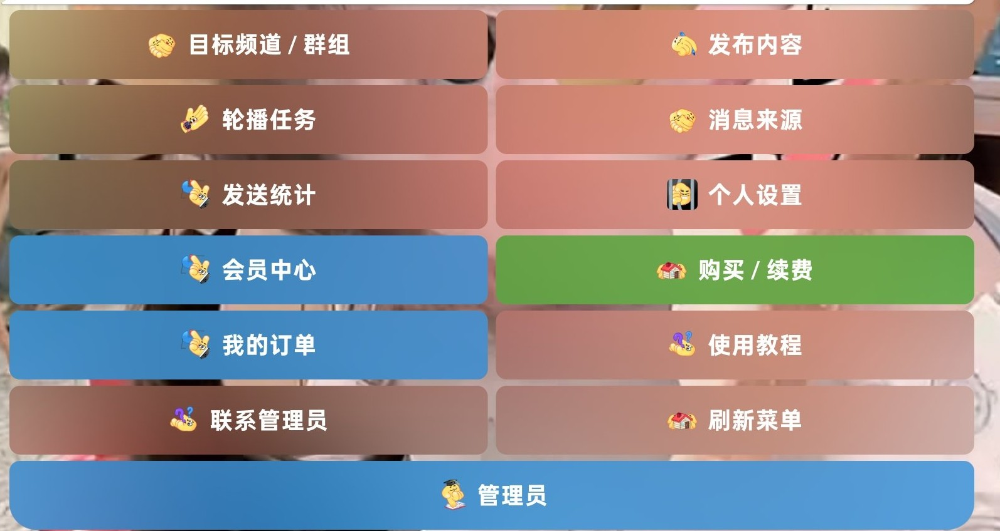

# TG 自动广告机器人

<p>
  
  
  
  
</p>

**中文** · [English](README.en.md)

Telegram 广告投放机器人：绑定频道/群组、保存广告内容、多目标定时轮播、来源新帖即时同步，带会员计费与完整管理后台。

> **在线演示**：<https://t.me/KunKunGuangGaoBot> —— 私聊发送 `/start` 即可查看菜单；系统管理员发送 `/admin`。

- 由 TG 困困开源 [@sad1881](https://t.me/sad1881) 困困承接各种业务 欢迎咨询

---

## 这是什么

一个不依赖网页后台的 Telegram 广告机器人。用户在私聊里完成全部操作：把要投放的频道、群组加进来，写好一条广告（文字、图片、视频、动画或文档），设置间隔和次数，任务就按计划轮流发出；也可以绑定一个来源频道，让新帖在几秒内同步到自己的目标。

所有内容、任务、逐条发送结果都写在 PostgreSQL 里，接收服务和发送 Worker 是两个独立进程，重启后按数据库状态继续。网络结果不明时**不会盲目重发**——记为 `UNKNOWN` 暂停，交给人核对后决定重发还是跳过。

代码使用官方 Bot API 长轮询，不使用用户账号 Session、非官方协议或任何绕过限制的手段。

## 功能预览



> 演示机器人 @KunKunGuangGaoBot 的实际主菜单：13 个入口全部带会员表情图标，会员、购买、订单入口用彩色按钮。

| 菜单 | 作用 |
| --- | --- |
| 🐱 目标频道 / 群组 | 批量粘贴用户名、链接或 Chat ID；底部选择器挑私密群组；双方管理员核验后绑定 |
| 📥 发布内容 | 文字 / 图片 / 视频 / 动画 / 文档；保留原生格式与会员表情实体；先预览再确认 |
| 🎠 轮播任务 | 多内容 A→B→C 循环、多目标、整数分钟或 `H:MM` 间隔、有限次数或无限 |
| 📣 消息来源 | 独立授权来源；复制已知消息（可带按钮）或原生转发；来源新帖即时排队 |
| 📊 发送统计 | 按个人时区统计今日数据；任务状态、逐目标发送/删除结果、错误与消息链接 |
| ⚙️ 个人设置 | IANA 时区、使用教程、联系管理员 |
| 💎 会员中心 | 套餐状态、目标用量、到期时间、永久加量额度 |
| 🧾 我的订单 | 订单号、金额、套餐、状态与付款入口 |
| 🏠 购买 / 续费 | 周 / 月 / 季套餐与永久加量，下单后在设置里查单 |
| 📖 使用教程 | 管理员可配置的图文教程 |
| 💬 联系管理员 | 管理员可配置的联系方式 |
| 🔄 刷新菜单 | 重新渲染主菜单（修复图标或按钮显示异常） |
| 🐳 管理员 | 用户/任务/广播/收费/白名单/审计，全部在私聊内完成 |

## 特性

- 📢 **多目标轮播**：一条内容可以同时投递到几十个频道和群组，按任务、目标和内容版本独立记录每一条投递结果。
- 🗂 **五类内容与版本**：文字、单张图片、视频、动画、文档；编辑生成新版本，已排队的发布事件带独立快照，改内容不会串改历史。
- 🔁 **删旧发新**：可配置在发新消息前删除本任务上一次发的那条，删除指针按任务与目标隔离，不会误删别人的消息。
- ⚡ **来源即时同步**：绑定来源频道后，新帖进入独立队列，与定时发布串行执行；事件去重、来源循环检测，不推进定时轮播游标。
- 🎨 **会员表情与彩色按钮**：直接解析消息中的自定义 emoji 实体和 `primary` / `success` / `danger` 按钮颜色，不需要手抄 emoji ID。
- 🧩 **按钮语法**：同排多按钮、换行、URL 按钮，随内容一起预览确认。
- 🛡 **机器人内管理后台**：用户查找与封禁、任务与日志总览、白名单配置、广播（含媒体、会员表情、保护内容）、20 格实时进度与失败导出、审计记录。
- 💳 **会员计费**：周 10U / 月 30U / 季 66U，永久加量 10 目标 3U / 50 目标 10U；收款凭据用独立 Fernet 密钥加密，密钥永不出现在会话、日志与审计正文里。
- 🧾 **SQL 持久化**：用户、绑定、来源、内容版本、任务、会话、发布快照、逐目标投递、广播接收者、消息与审计全部落库；正文长期保留，媒体只存 file_id。
- 🚦 **限流与恢复**：跨进程共享免费发送额度，遵守全局与单聊天限制与 `retry_after`；服务崩溃后按 SQL 恢复，残留的在途请求进入 `UNKNOWN`。
- 🔍 **健康检查与备份**：`scripts/health.py` 用心跳判断真实可用性（进程活着不等于能发出去）；`scripts/backup.py` / `scripts/restore.py` 做一致性快照与空库恢复核验。

## 目录结构

```text
tg-auto-ad-bot/
├── adbot/
│   ├── main.py           # 接收服务：先持久化 updates，再处理交互与来源摄取
│   ├── worker.py         # Worker：轮播、即时事件、逐目标发送、广播进度、测试删除
│   ├── engine.py         # 任务引擎：SQL 状态机、幂等标识、限流、权限、恢复、UNKNOWN
│   ├── ui.py             # 用户与管理员菜单、预览、向导、确认、SQL 会话
│   ├── billing_ui.py     # 会员中心、订单、购买、收费后台
│   ├── content.py        # 实体、按钮、媒体、复制/转发、图标发现
│   ├── payments.py       # OKPay 签名、查单、订单状态机
│   ├── entitlements.py   # 会员权益、目标用量、发送门禁
│   ├── db.py             # asyncpg 连接池与按序迁移
│   ├── config.py         # .env 解析与校验
│   └── network.py        # Bot API 超时与 TLS 处理
├── migrations/           # 001 初始化 / 002 调度 / 003 共享限流 / 004 计费
├── deploy/               # 两个 systemd 单元
├── scripts/              # health / backup / restore / live 诊断、中英文档校验
├── tests/                # 481 项自动测试
├── docs/                 # 功能、使用、收费、部署、验收报告（英文版在 docs/en/）
├── CONTRACT.md           # 模块接口与业务约定（英文：CONTRACT.en.md）
├── BILLING_CONTRACT.md   # 支付、额度、门禁、敏感输入约定
├── SECURITY.md           # 安全说明与漏洞报告渠道（英文：SECURITY.en.md）
└── .env.example          # 不含任何真实凭据
```

## 技术栈

- Python 3.12，全异步（`asyncio`），无 Web 框架、无 Redis、无 MySQL。
- [python-telegram-bot](https://github.com/python-telegram-bot/python-telegram-bot) 22.8 长轮询。
- PostgreSQL 16 + asyncpg 0.31，迁移在首次启动时按文件名顺序执行。
- httpx 0.28、python-dotenv 1.2、cryptography 46（Fernet 加密支付凭据）。
- systemd 管理两个服务，SQL advisory lock 阻止同角色双实例。

## 快速开始

要求：Python 3.12+、PostgreSQL 16、Ubuntu / Debian 系（其他发行版把 `apt` 与 `runuser` 换成对应命令即可）。

```bash
# 1. 取代码与依赖
git clone https://github.com/KunKun24/tg-auto-ad-bot.git
cd tg-auto-ad-bot
python3 -m venv .venv
.venv/bin/pip install -r requirements.txt

# 2. 建系统账号与数据库（socket peer 认证，数据库不开公网端口）
sudo useradd --system --home-dir /opt/tg-auto-ad --no-create-home --shell /usr/sbin/nologin adbot
sudo runuser -u postgres -- createuser --login adbot
sudo runuser -u postgres -- createdb --owner=adbot auto_ad
sudo runuser -u postgres -- psql -c "ALTER ROLE adbot SET timezone TO 'UTC';"

# 3. 私有配置
cp .env.example .env
.venv/bin/python -c 'from cryptography.fernet import Fernet; print(Fernet.generate_key().decode())'
# 把 Token、管理员 ID、上面生成的密钥分别填进 BOT_TOKEN、ADMIN_IDS、BILLING_ENCRYPTION_KEY
chmod 600 .env

# 4. 启动（首次自动建表）
.venv/bin/python -m adbot.main
```

另一个终端跑 Worker：

```bash
.venv/bin/python -m adbot.worker
```

然后私聊机器人发送 `/start`；`ADMIN_IDS` 里的账号发送 `/admin` 进入管理后台。

### 用 systemd 常驻

```bash
sudo install -m 644 deploy/tg-auto-ad-bot.service    /etc/systemd/system/
sudo install -m 644 deploy/tg-auto-ad-worker.service /etc/systemd/system/
sudo systemctl daemon-reload
sudo systemctl enable --now tg-auto-ad-worker.service tg-auto-ad-bot.service
```

改部署目录时，要同步修改单元文件里的 `WorkingDirectory`、`EnvironmentFile`、`ExecStart`、`ReadWritePaths` 和虚拟环境路径。

### 主要配置项

| 变量 | 说明 |
| --- | --- |
| `BOT_TOKEN` | BotFather 发放的 Token，仅存在 `.env` |
| `ADMIN_IDS` | 逗号分隔的系统管理员 Telegram 用户 ID |
| `DATABASE_URL` | 默认走本机 UNIX socket：`postgresql://adbot@/auto_ad?host=/var/run/postgresql` |
| `BILLING_ENCRYPTION_KEY` | Fernet 密钥，加密支付凭据；**丢失后历史订单无法解密查单**，必须单独备份 |
| `TELEGRAM_API_IPS` | 可选，DNS 异常时填已核实的 API IP，仅本进程生效，TLS 校验保持开启 |
| `POLL_TIMEOUT` / `WORKERS` | 长轮询超时秒数与处理并发 |

## 部署与运维

```bash
# 健康检查：接收心跳 100s、Worker 心跳 120s 内返回 0
runuser -u adbot -- .venv/bin/python scripts/health.py

# 一致性备份（pg_dump 自定义格式 + pg_restore --list 校验）
runuser -u adbot -- .venv/bin/python scripts/backup.py

# 恢复到全新空库（拒绝覆盖当前库或任何非空库）
runuser -u adbot -- .venv/bin/python scripts/restore.py backups/所选备份.dump --target auto_ad_recovery
```

服务日志：

```bash
journalctl -u tg-auto-ad-bot.service -u tg-auto-ad-worker.service -n 100 --no-pager
```

完整流程见[部署与维护](docs/部署与维护.md)。

## 测试

自动测试使用独立测试库、随机 schema 和假 Bot 对象，不读真实 Token、不向真实用户外发、不联网：

```bash
runuser -u adbot -- env PYTHONDONTWRITEBYTECODE=1 .venv/bin/python -m pytest -p no:cacheprovider -q
```

```text
481 passed, 10 warnings in 134.50s
```

覆盖：内容解析与实体偏移、界面归属隔离、真实 SQL 状态机与竞态、2000 用户 / 10000 绑定的调度完整性、支付签名与查单、密钥脱敏、计费权益。分布与真实 Telegram 验收范围见[测试与验收报告](docs/测试与验收报告.md)。

`scripts/live_*.py` 会向预配置的管理员真实发消息，属于人工诊断工具，不要加进自动测试。

## 安全说明

- `.env` 不会也不应进入版本库：仓库只提供 [.env.example](.env.example) 占位。
- 支付商户号与密钥用 `BILLING_ENCRYPTION_KEY` 加密后落库；密钥仅存于进程内存与 `.env`。
- 管理员私聊里粘贴的密钥文本，会在持久化之前被替换为脱敏占位，不进入会话、原始 update、审计正文或日志。
- 数据库仅监听本机；机器人不开放任何入站端口，运维通过 systemd 与脚本完成。
- 部署前请轮换任何曾经出现在聊天、工单或截图里的 Token。

## 免责声明

本项目仅供学习交流与合法的自有渠道运营使用。使用者需遵守 Telegram 服务条款、
所在地区法律以及目标群组/频道的规则。**严禁用于垃圾信息群发、欺诈或任何违法用途**；
因滥用导致的封号、法律或经济后果由使用者自行承担。

第三方支付渠道（USDT）**并非 Telegram 官方结算方式**，存在账号限制与支付失败风险，
是否采用请自行判断并承担后果。

## 文档

| 文档 | 内容 | English |
| --- | --- | --- |
| [功能介绍](docs/功能介绍.md) | 当前功能与平台边界 | [features](docs/en/features.md) |
| [使用说明](docs/使用说明.md) | 绑定、内容、按钮、任务与管理员操作 | [usage](docs/en/usage.md) |
| [收费使用说明](docs/收费使用说明.md) | 套餐、加量、购买、订单、收款配置与权益调整 | [billing](docs/en/billing.md) |
| [收费升级报告](docs/收费升级报告.md) | 计费设计与真实踩坑、481 项测试、待验证范围 | [billing report](docs/en/billing-report.md) |
| [部署与维护](docs/部署与维护.md) | 全新部署、systemd、健康检查、备份与恢复 | [deployment](docs/en/deployment.md) |
| [测试与验收报告](docs/测试与验收报告.md) | 测试分布、容量烟测、真实 Telegram 验收范围 | [acceptance report](docs/en/acceptance-report.md) |
| [模块契约](CONTRACT.md) | 开发接口与业务约定 | [contract](CONTRACT.en.md) |
| [收费模块契约](BILLING_CONTRACT.md) | 支付、会员额度、发送门禁与敏感输入接口 | English only |
| [安全策略](SECURITY.md) | 漏洞报告与凭据泄露处理 | [security](SECURITY.en.md) |

所有英文文档的目录入口在 [`docs/en/`](docs/en/)。

## License

[MIT](./LICENSE) © 2026 TG 自动广告机器人 · TG 困困 @sad1881

---

## 关于 AIGC

> 项目包含 AIGC 内容，AI 减少了开发时间；我们也认真审核了每一条代码。
